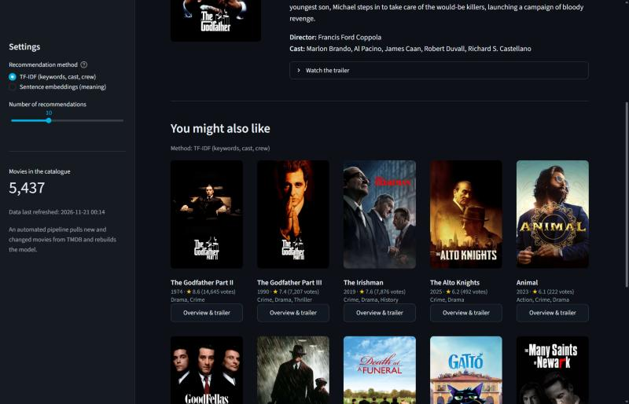
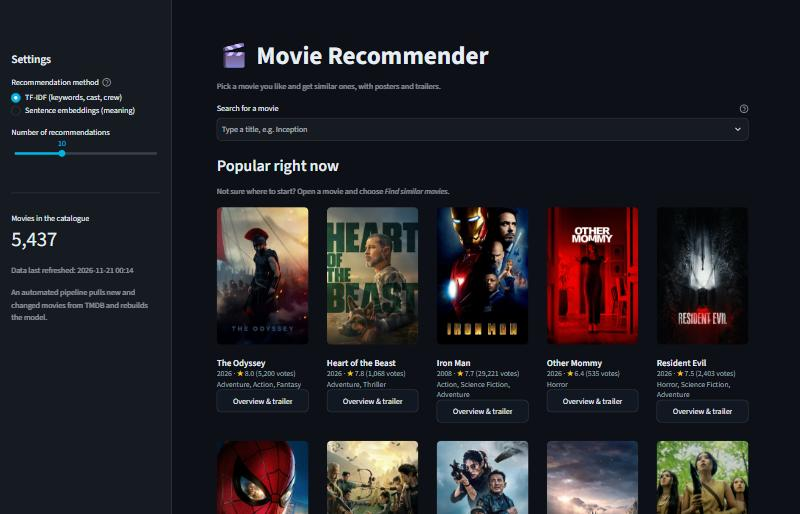
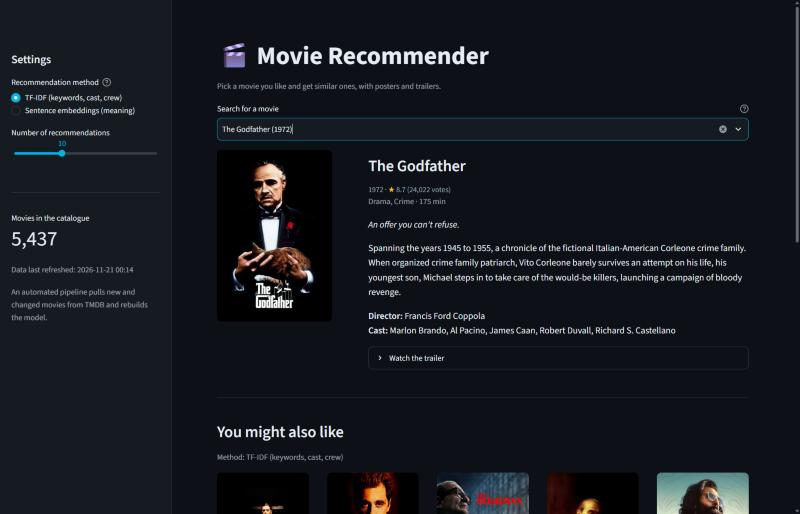
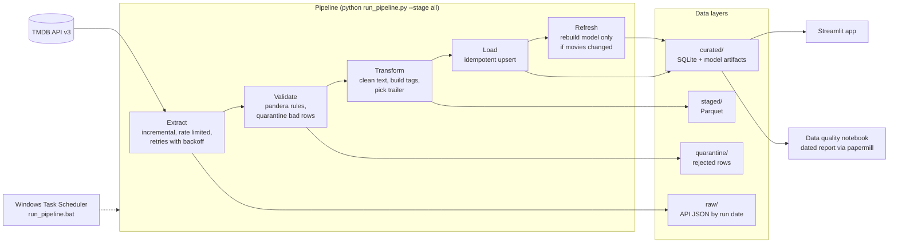
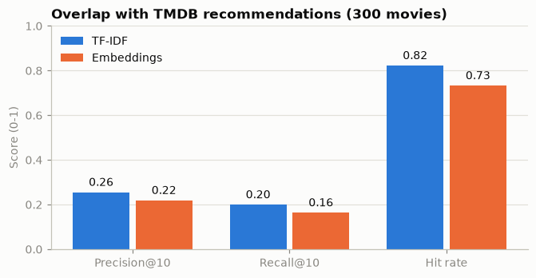
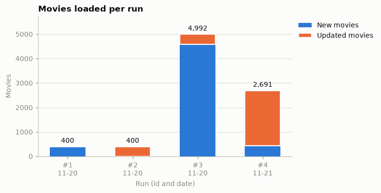

# Movie Recommender with an Automated TMDB Pipeline

A content-based movie recommendation app backed by a scheduled ETL pipeline. Pick a movie and get ten
similar ones as a poster grid, each with its rating, genres, overview and YouTube trailer. Behind the
app, a pipeline pulls new and changed movies from the TMDB API, validates them, loads them into SQLite
and rebuilds the recommender only when the catalogue has changed.

**Live demo:** _add the Streamlit Community Cloud link here after deploying_



## Contents

- [Problem](#problem)
- [What it does](#what-it-does)
- [Architecture](#architecture)
- [Results](#results)
- [Setup](#setup)
- [Running the pipeline](#running-the-pipeline)
- [Scheduling](#scheduling)
- [Monitoring](#monitoring)
- [Deploying the app](#deploying-the-app)
- [Project structure](#project-structure)
- [Limitations](#limitations)
- [Future work](#future-work)
- [Attribution](#attribution)

## Problem

Most recommender tutorials stop at a notebook trained once on a static CSV. That leaves out the parts
that matter in practice:

- **The data goes stale.** New films are released every week, and ratings and trailers change.
- **Source data is messy.** Real API responses have missing overviews, missing posters and duplicate IDs.
- **Nobody can tell whether it is still working.** There is no run history and no data quality check.

This project treats the recommender as a small data product: an incremental, idempotent pipeline with
validation, logging and a quality report feeds a model that is rebuilt only when needed, and a
lightweight app serves the result.

## What it does

| | |
|---|---|
| **Search** | Type-to-filter box over every movie in the catalogue (about 5,400). |
| **Recommend** | Ten similar movies (5 to 20, adjustable) from either of two methods, switchable in the sidebar. |
| **Browse** | Poster grid with title, year, rating and genres. A pop-up shows the overview and plays the trailer. |
| **Stay fresh** | A scheduled pipeline adds new releases and refreshes changed movies. |
| **Stay honest** | Bad rows are quarantined, every run is logged, and a dated quality report is produced. |

| Home | Selected movie |
|---|---|
|  |  |

## Architecture



### Stages

| Stage | What happens | Module |
|---|---|---|
| **Extract** | Discovers about 5,000 movie IDs (now playing, upcoming, most-voted, popular), then fetches details only for movies that are new, reported as changed by TMDB, or older than 30 days. Handles pagination, HTTP 429 with `Retry-After`, and retries with exponential backoff. Raw JSON is saved untouched by run date. | [`pipeline/extract.py`](pipeline/extract.py) |
| **Validate** | Checks for empty titles, duplicate IDs, ratings outside 0–10, missing or too-short overviews and unparseable dates. Failing rows go to `data/quarantine/` with the reason; the run continues. Malformed poster paths and trailer keys are repaired to empty and counted as warnings. | [`pipeline/validate.py`](pipeline/validate.py) |
| **Transform** | Cleans text, flattens genres, cast and crew into tables, picks the best YouTube trailer (official trailer first), and builds the two text fields the models use. Output is Parquet. | [`pipeline/transform.py`](pipeline/transform.py) |
| **Load** | Upserts into SQLite in one transaction. Re-running the same data creates no duplicates. | [`pipeline/load.py`](pipeline/load.py) |
| **Refresh** | Rebuilds both models only when the set of movies in the database differs from the saved model. Embeddings are cached per movie, so only new or changed texts are encoded. | [`pipeline/refresh_model.py`](pipeline/refresh_model.py) |
| **Log** | One row per run in the `pipeline_runs` table (status, duration, row counts, error message) plus a rotating log file. | [`pipeline/run_pipeline.py`](pipeline/run_pipeline.py) |

### Database tables

`movies`, `genres`, `cast_crew`, `trailers` and `pipeline_runs`, in `data/curated/movies.db`.

### Design decisions

- **SQLite over DuckDB.** The data is small and row-oriented, upserts are native, and it ships with Python, so the deployed app needs no extra dependency.
- **pandera over Great Expectations.** The rules fit in one readable schema, without a separate project scaffold.
- **Precomputed neighbours, not a similarity matrix.** A full 5,000 × 5,000 matrix is about 100 MB per method. Storing the top 30 neighbours per movie is 1.6 MB for both methods, and the app answers a query with one array lookup.
- **The app never calls the API.** It reads only the curated layer, so it needs no API key, starts fast and keeps working when TMDB is unreachable.
- **The curated layer is committed to git; raw and staged are not.** The deployed app needs the database and model; the other layers can be rebuilt from the API.

## Results

Two content-based methods are built from the same fields (genres, keywords, top five cast, director, overview):

- **TF-IDF + cosine similarity** on a "tag soup", where names are joined into single tokens (`christophernolan`).
- **Sentence embeddings + cosine similarity** using `all-MiniLM-L6-v2` on a readable description of each movie.

Both are scored on the 300 most-voted movies by how much their top 10 overlaps with TMDB's own
`/movie/{id}/recommendations`.

| Method | Precision@10 | Recall@10 | Hit rate |
|---|---|---|---|
| **TF-IDF + cosine** | **0.256** | **0.200** | **0.823** |
| Embeddings + cosine | 0.219 | 0.164 | 0.733 |



TF-IDF wins on every metric, so it is the app's default. How to read the numbers:

- **The benchmark is behaviour-based.** TMDB's list reflects what people watch together, which a content-only model cannot see, so scores near 1.0 are not expected. The comparison between the two methods is the useful part.
- **The two methods disagree a lot.** On average they share only 1.7 of their 10 picks.
- **TF-IDF is strongest on franchises and crews.** Exact name matches surface sequels and films by the same director.
- **Embeddings are often tighter on theme.** They do not depend on shared names, which helps for films like *Inception* and *Parasite*.

Spot-checks (top five from each method):

| Movie | TF-IDF | Embeddings |
|---|---|---|
| Toy Story | Toy Story 2, 3, 4, 5, Lightyear | Toy Story 2, 4, 3, 5, Ted 2 |
| The Godfather | Part II, Part III, The Irishman, The Alto Knights, Animal | Part III, Part II, Donnie Brasco, Tokyo Godfathers, American Gangster |
| Inception | The Death of Robin Hood, In the Grey, Apex, Tenet, New World | Dream Scenario, Criminal, In the Grey, Source Code, Primer |
| Parasite | Possible Love, Joker, Bad Apples, The Host, Triangle of Sadness | The Host, New World, Killer Klowns from Outer Space, Exhuma, KPop Demon Hunters |

The *Inception* and *Parasite* rows show the weakness of each approach plainly; see [Limitations](#limitations).

### Pipeline numbers

| | |
|---|---|
| Movies in the database | 5,437 |
| First full load | 5,002 fetched, 4,992 valid, 10 quarantined (missing overview), about 6.5 minutes |
| Next-day incremental run | 2,699 fetched (453 new, 2,246 changed), 8 quarantined, about 5.5 minutes |
| Model refresh after that run | 461 texts re-encoded, 4,976 reused |
| Trailer coverage | 96.4% |
| Automated tests | 72 |



## Setup

Requirements: Python 3.11 or newer and a free [TMDB API key](https://www.themoviedb.org/settings/api)
(v3 auth). The commands below are for Windows PowerShell.

```powershell
git clone https://github.com/<your-username>/<your-repo>.git
cd <your-repo>
python -m venv .venv
.\.venv\Scripts\Activate.ps1
pip install -r requirements-pipeline.txt
Copy-Item .env.example .env
```

Open `.env` and set `TMDB_API_KEY` to your key. The file is git-ignored; the key is never hardcoded or logged.

There are two requirements files:

| File | Use |
|---|---|
| `requirements.txt` | The app only (Streamlit, pandas, numpy, joblib). This is what Streamlit Community Cloud installs. |
| `requirements-pipeline.txt` | Everything: pipeline, models (includes PyTorch), notebooks and tests. |

To run just the app against the committed data, no key is needed:

```powershell
pip install -r requirements.txt
streamlit run app.py
```

## Running the pipeline

```powershell
python run_pipeline.py --stage all
```

| Command | Effect |
|---|---|
| `python run_pipeline.py --stage all` | Extract → validate and transform → load → refresh model |
| `python run_pipeline.py --stage all --full-refresh` | Re-fetch every movie and force a model rebuild |
| `python run_pipeline.py --stage extract` | One stage only (`extract`, `transform`, `load` or `refresh`) |
| `python run_pipeline.py --stage transform --run-date 2026-11-20` | Reprocess a specific run date |

Every stage is safe to re-run. The exit code is `0` on success and `1` on failure.

Run the tests (no network or API key needed):

```powershell
python -m pytest tests -q
```

## Scheduling

[`run_pipeline.bat`](run_pipeline.bat) activates the virtual environment, runs the pipeline, appends
output to `logs\scheduler.log`, then produces the dated quality report. To run it daily at 09:00 with
Windows Task Scheduler (adjust the path):

```powershell
schtasks /Create /TN "TMDB Recommender Pipeline" /TR "\"C:\path\to\project\run_pipeline.bat\"" /SC DAILY /ST 09:00 /F
```

The full guide, including the GUI steps, a manual test, result codes and a troubleshooting table, is in
[docs/scheduling.md](docs/scheduling.md).

## Monitoring

- **`pipeline_runs` table:** status, duration and row counts for every run, including failed ones.
- **`logs/pipeline.log`:** rotating log with full tracebacks.
- **[`notebooks/02_data_quality_monitor.ipynb`](notebooks/02_data_quality_monitor.ipynb):** run history, quarantine reasons, completeness, freshness, model comparison and a pass / warn / fail checklist.
- **[`notebooks/01_pipeline_runner.ipynb`](notebooks/01_pipeline_runner.ipynb):** runs the pipeline from a notebook with parameters.

papermill executes the monitor notebook into a dated copy, so each scheduled run leaves a record:

```powershell
python -m pipeline.report --html
```

Output: `notebooks/reports/02_data_quality_monitor_<date>.ipynb` and `.html`.

## Deploying the app

The app runs on [Streamlit Community Cloud](https://streamlit.io/cloud) straight from the repository.

1. Push the repository to GitHub, including `data/curated/` (about 30 MB).
2. On Streamlit Community Cloud choose **New app**, select the repository and set the main file to `app.py`.
3. Deploy. Cloud installs `requirements.txt`; the dark theme comes from `.streamlit/config.toml`.

**About the API key:** the deployed app does not need one, because it only reads the committed curated
data. If you later add a feature that calls TMDB from the app, put the key in the app's
**Settings → Secrets** as `TMDB_API_KEY = "..."`, never in the repository.

**Custom subdomain:** shared web hosting cannot run a Streamlit server, so the subdomain either shows
the Cloud app through a one-file embed page ([`deploy/subdomain/index.html`](deploy/subdomain/index.html))
or points at an app host that supports custom domains. Both routes are in
[docs/deployment.md](docs/deployment.md).

**Keeping the deployed app fresh:** the pipeline runs on your machine, so the live app updates when you
commit and push the changed files in `data/curated/` after a run.

## Project structure

```
├── app.py                         Streamlit app (reads data/curated only)
├── run_pipeline.py                Entry point: python run_pipeline.py --stage all
├── run_pipeline.bat               Used by Windows Task Scheduler
├── requirements.txt               App dependencies (used by Streamlit Cloud)
├── requirements-pipeline.txt      Pipeline, models, notebooks, tests
├── .env.example                   Template for TMDB_API_KEY
├── .streamlit/config.toml         Dark theme
├── pipeline/
│   ├── config.py                  Paths and settings in one place
│   ├── extract.py                 TMDB client, incremental fetch plan
│   ├── validate.py                pandera rules, quarantine
│   ├── transform.py               Cleaning, tags, trailer selection, Parquet
│   ├── load.py                    SQLite schema, upsert, pipeline_runs
│   ├── refresh_model.py           TF-IDF + embeddings, evaluation
│   ├── recommender.py             Lightweight lookup used by the app
│   ├── run_pipeline.py            Orchestrator and CLI
│   ├── report.py                  papermill report runner
│   └── logging_setup.py           Rotating file + console logging
├── notebooks/
│   ├── 01_pipeline_runner.ipynb
│   ├── 02_data_quality_monitor.ipynb
│   └── reports/                   Dated papermill output (git-ignored)
├── data/
│   ├── raw/                       API JSON by run date (git-ignored)
│   ├── staged/                    Parquet (git-ignored)
│   ├── quarantine/                Rejected rows (git-ignored)
│   └── curated/                   movies.db + model artifacts (committed)
├── docs/                          Scheduling guide, images
├── tests/                         72 tests, no network needed
└── logs/                          pipeline.log, scheduler.log (git-ignored)
```

## Limitations

- **Content only.** The models know what a film is about, not what people enjoy together. That caps agreement with behaviour-based lists and gives no personalisation.
- **TF-IDF is fooled by shared names.** One shared actor or keyword can pull in an unrelated film (a musical comedy appears among *Inception*'s matches).
- **Embeddings lean on surface cues.** *Parasite*'s matches skew towards "Korean film" more than towards its themes.
- **The evaluation is a proxy.** TMDB's recommendations are not ground truth, and only the 300 most-voted movies are scored.
- **The catalogue only grows.** Movies that drop off TMDB's lists are never removed, so the database gets larger with each run (about 450 movies were added in one day).
- **Daily runs are not small.** TMDB reports a large share of popular movies as changed each day, so an incremental run still fetches around 2,000 movies and takes about five minutes.
- **One run date at a time.** Transform and load process the latest date by default; older dates need `--run-date`.
- **Quarantined movies are re-fetched** on every run until TMDB fixes them.
- **The deployed app is only as fresh as the last push** of `data/curated/`.
- **English only.** Overviews and the embedding model are English; `/search/movie` is not used because search runs over the local catalogue.
- **Local scheduling.** Task Scheduler needs the PC to be on; a missed run is caught up at the next start if that option is enabled.

## Future work

- **Hybrid ranking:** blend the two similarity scores, and re-rank by rating and popularity to push down obscure near-matches.
- **Field weighting for TF-IDF:** down-weight cast relative to genres and keywords to reduce name-only matches.
- **Collaborative signal:** add a ratings dataset (for example MovieLens, joined on IMDb ID) for "people who liked this also liked".
- **Catalogue pruning:** cap the size, or retire movies not seen on any list for several months.
- **Cloud scheduling:** move the pipeline to GitHub Actions on a cron trigger and commit the curated layer automatically, so the live app refreshes without a local PC.
- **Better evaluation:** more movies, a held-out set of human-judged pairs, and diversity and coverage metrics.
- **App features:** filters for genre, year and minimum rating, multi-movie input, and "where to watch" links.

## Attribution

This product uses the TMDB API but is not endorsed or certified by TMDB.

Movie data and images are from [The Movie Database (TMDB)](https://www.themoviedb.org/). Trailers are played from YouTube.
